# Performance Management System (PMS) - Database ER Diagram
**Date**: 5th August 2026  
**Architecture**: Relational Database Schema (Laravel Migrations Specification)

---

## 🎨 Visual Database Architecture Diagram

---

## 📐 Entity-Relationship Diagram (Mermaid)

```mermaid
erDiagram

    %% ==========================================
    %% CORE SYSTEM ENTITIES
    %% ==========================================
    USERS {
        unsignedInteger emp_id PK
        string college_id UK
        string name
        string college_email_id UK
        string password
        enum role "staff | teacher | hod | establishment | principal | admin"
        enum designation "professor | associate_professor | assistant_professor | hod"
        enum status "active | inactive | retired | suspended"
        timestamp created_at
        timestamp updated_at
    }

    %% ==========================================
    %% PROFILE & PERSONAL DETAILS
    %% ==========================================
    USER_BASIC_DETAILS {
        bigint id PK
        unsignedInteger emp_id FK
        string profile_pic
        string aadhaar_number UK "12 digits"
        string pancard_number UK "10 digits"
        text present_address
        date dob "YYYY-MM-DD"
        enum blood_group "A+ | A- | B+ | B- | AB+ | AB- | O+ | O-"
        string contact_number "10 digits"
        timestamp created_at
        timestamp updated_at
    }

    USER_PROFESSIONAL_DETAILS {
        bigint id PK
        unsignedInteger emp_id FK
        date date_of_joining
        date relieving_date
        enum faculty_serving "permanent | part-time | contractual"
        date retirement_date
        date last_promotion_date
        timestamp created_at
        timestamp updated_at
    }

    %% ==========================================
    %% ACADEMIC QUALIFICATIONS
    %% ==========================================
    USER_SECONDARY_QUALIFICATION_DETAILS {
        bigint id PK
        unsignedInteger emp_id FK
        string name_of_school
        string board
        text school_address
        enum marking_scheme "percentage | cgpa"
        decimal percentage "5,2"
        decimal cgpa "4,2"
        unsignedSmallInteger year_of_passing
        timestamp created_at
        timestamp updated_at
    }

    USER_HIGHER_SECONDARY_QUALIFICATION_DETAILS {
        bigint id PK
        unsignedInteger emp_id FK
        string name_of_school
        string board
        text school_address
        enum marking_scheme "percentage | cgpa"
        decimal percentage "5,2"
        decimal cgpa "4,2"
        unsignedSmallInteger year_of_passing
        timestamp created_at
        timestamp updated_at
    }

    USER_UNDERGRADUATE_QUALIFICATION_DETAILS {
        bigint id PK
        unsignedInteger emp_id FK
        string name_of_college
        string university
        text college_address
        string course
        string branch
        enum marking_scheme "percentage | cgpa"
        decimal percentage "5,2"
        decimal cgpa "4,2"
        unsignedSmallInteger year_of_passing
        timestamp created_at
        timestamp updated_at
    }

    USER_POSTGRADUATE_QUALIFICATION_DETAILS {
        bigint id PK
        unsignedInteger emp_id FK
        string name_of_college
        string university
        text college_address
        string course
        string branch
        enum marking_scheme "percentage | cgpa"
        decimal percentage "5,2"
        decimal cgpa "4,2"
        unsignedSmallInteger year_of_passing
        timestamp created_at
        timestamp updated_at
    }

    USER_DOCTORATE_QUALIFICATION_DETAILS {
        bigint id PK
        unsignedInteger emp_id FK
        string name_of_college
        string university
        text college_address
        string course
        string branch
        enum marking_scheme "percentage | cgpa"
        decimal percentage "5,2"
        decimal cgpa "4,2"
        unsignedSmallInteger year_of_passing
        timestamp created_at
        timestamp updated_at
    }

    %% ==========================================
    %% WORK EXPERIENCES
    %% ==========================================
    USER_TEACHING_EXPERIENCES {
        bigint id PK
        unsignedInteger emp_id FK
        string organization
        text organization_address
        string designation
        date joining_date
        date relieving_date
        unsignedInteger experience_months
        timestamp created_at
        timestamp updated_at
    }

    USER_INDUSTRY_EXPERIENCES {
        bigint id PK
        unsignedInteger emp_id FK
        string organization
        text organization_address
        string designation
        date joining_date
        date relieving_date
        unsignedInteger experience_months
        timestamp created_at
        timestamp updated_at
    }

    %% ==========================================
    %% INSTRUCTIONAL WORK & THESIS SUPERVISION
    %% ==========================================
    INSTRUCTIONAL_WORK_ASSIGNEDS {
        bigint id PK
        unsignedInteger emp_id FK
        unsignedTinyInteger semester
        string course_code "20 chars"
        string course_title
        unsignedSmallInteger lecture_hours_per_week
        unsignedSmallInteger tutorial_hours_per_week
        unsignedSmallInteger practical_hours_per_week
        unsignedSmallInteger strength_of_class
        decimal result_percentage_a_grade "5,2"
        decimal result_percentage_pass "5,2"
        text comments
        unsignedInteger commented_by_emp_id FK
        timestamp created_at
        timestamp updated_at
    }

    BTECH_PROJECT_SUPERVISIONS {
        bigint id PK
        unsignedInteger emp_id FK
        string name_of_student
        string urn_of_student "30 chars"
        string co_supervisor_name
        enum course_work_status "completed | not_completed"
        date date_of_submission
        text comments
        unsignedInteger commented_by_emp_id FK
        timestamp created_at
        timestamp updated_at
    }

    MTECH_THESIS_SUPERVISIONS {
        bigint id PK
        unsignedInteger emp_id FK
        string name_of_student
        string urn_of_student "30 chars"
        string co_supervisor_name
        enum course_work_status "completed | not_completed"
        text comments
        unsignedInteger commented_by_emp_id FK
        timestamp created_at
        timestamp updated_at
    }

    PHD_THESIS_SUPERVISIONS {
        bigint id PK
        unsignedInteger emp_id FK
        string name_of_student
        string registration_number_of_student "50 chars"
        string co_supervisor_name
        enum course_work_status "not_started | in_progress | completed"
        enum research_work_status "not_started | in_progress | completed"
        text comments
        unsignedInteger commented_by_emp_id FK
        timestamp created_at
        timestamp updated_at
    }

    %% ==========================================
    %% ACADEMIC PERFORMANCE & CONTRIBUTIONS
    %% ==========================================
    ADDITIONAL_DUTIES {
        bigint id PK
        unsignedInteger emp_id FK
        string position
        enum level "departmental | college | state | national | international"
        string period
        string documented_proof
        text comments
        unsignedInteger commented_by_emp_id FK
        timestamp created_at
        timestamp updated_at
    }

    ACTIVITY_ORGANIZEDS {
        bigint id PK
        unsignedInteger emp_id FK
        string title
        string duration
        string major_sponsors
        enum level "departmental | college | state | national | international"
        string documented_proof
        text comments
        unsignedInteger commented_by_emp_id FK
        timestamp created_at
        timestamp updated_at
    }

    RESEARCH_PAPERS {
        bigint id PK
        unsignedInteger emp_id FK
        string title
        text authors
        string journal_or_conference_details
        enum level "state | national | international"
        string documented_proof
        text comments
        unsignedInteger commented_by_emp_id FK
        timestamp created_at
        timestamp updated_at
    }

    SPONSORED_PROJECTS {
        bigint id PK
        unsignedInteger emp_id FK
        string title
        string position
        string sponsor_name
        date date_of_commencement
        string duration
        enum status "completed | ongoing"
        string documented_proof
        text comments
        unsignedInteger commented_by_emp_id FK
        timestamp created_at
        timestamp updated_at
    }

    CONSULTANCY_PROJECTS {
        bigint id PK
        unsignedInteger emp_id FK
        string title
        decimal cost "12,2"
        string position
        string sponsor_name
        date date_of_commencement
        string duration
        enum status "completed | ongoing"
        string documented_proof
        text comments
        unsignedInteger commented_by_emp_id FK
        timestamp created_at
        timestamp updated_at
    }

    ACADEMIC_PARTICIPATIONS {
        bigint id PK
        unsignedInteger emp_id FK
        string title
        string duration
        string institution
        string position
        enum category "seminar | workshop | conference | fdp | training | mooc"
        enum level "departmental | college | state | national | international"
        string documented_proof
        text comments
        unsignedInteger commented_by_emp_id FK
        timestamp created_at
        timestamp updated_at
    }

    %% ==========================================
    %% ANNUAL APPRAISAL REPORTS
    %% ==========================================
    ANNUAL_APPRAISAL_REPORTS {
        bigint id PK
        unsignedInteger emp_id FK
        unsignedInteger reporting_officer_emp_id FK
        unsignedInteger reviewing_officer_emp_id FK
        unsignedInteger principal_emp_id FK
        string academic_year "10 chars"
        unsignedTinyInteger initiative "Rating 1-5"
        unsignedTinyInteger responsibility "Rating 1-5"
        unsignedTinyInteger punctuality "Rating 1-5"
        unsignedTinyInteger commitment "Rating 1-5"
        unsignedTinyInteger loyalty "Rating 1-5"
        unsignedTinyInteger development "Rating 1-5"
        unsignedTinyInteger oral_communication "Rating 1-5"
        unsignedTinyInteger written_communication "Rating 1-5"
        unsignedTinyInteger teamwork "Rating 1-5"
        unsignedTinyInteger leadership "Rating 1-5"
        unsignedTinyInteger relationship_with_fellow_faculty_and_staff "Rating 1-5"
        unsignedTinyInteger maturity "Rating 1-5"
        unsignedTinyInteger temperament "Rating 1-5"
        unsignedTinyInteger relationship_with_students "Rating 1-5"
        unsignedSmallInteger total_score
        enum overall_appraisal "outstanding | very_good | good | average | poor"
        text reporting_officer_comments
        text reviewing_officer_remarks
        text principal_comments
        timestamp created_at
        timestamp updated_at
    }

    %% ==========================================
    %% RELATIONSHIP DEFINITIONS (CARDINALITIES)
    %% ==========================================
    USERS ||--|| USER_BASIC_DETAILS : "1:1 (Profile Details)"
    USERS ||--|| USER_PROFESSIONAL_DETAILS : "1:1 (Employment Details)"
    
    USERS ||--o| USER_SECONDARY_QUALIFICATION_DETAILS : "1:1 (10th Qualification)"
    USERS ||--o| USER_HIGHER_SECONDARY_QUALIFICATION_DETAILS : "1:1 (12th Qualification)"
    USERS ||--o| USER_UNDERGRADUATE_QUALIFICATION_DETAILS : "1:1 (UG Degree)"
    USERS ||--o| USER_POSTGRADUATE_QUALIFICATION_DETAILS : "1:1 (PG Degree)"
    USERS ||--o| USER_DOCTORATE_QUALIFICATION_DETAILS : "1:1 (PhD Degree)"

    USERS ||--o{ USER_TEACHING_EXPERIENCES : "1:N (Past Teaching)"
    USERS ||--o{ USER_INDUSTRY_EXPERIENCES : "1:N (Past Industry Work)"

    USERS ||--o{ INSTRUCTIONAL_WORK_ASSIGNEDS : "1:N (Assigned Courses)"
    USERS ||--o{ BTECH_PROJECT_SUPERVISIONS : "1:N (Guided BTech Projects)"
    USERS ||--o{ MTECH_THESIS_SUPERVISIONS : "1:N (Guided MTech Theses)"
    USERS ||--o{ PHD_THESIS_SUPERVISIONS : "1:N (Guided PhD Scholars)"

    USERS ||--o{ ADDITIONAL_DUTIES : "1:N (Assigned Administrative Duties)"
    USERS ||--o{ ACTIVITY_ORGANIZEDS : "1:N (Organized Events)"
    USERS ||--o{ RESEARCH_PAPERS : "1:N (Publications)"
    USERS ||--o{ SPONSORED_PROJECTS : "1:N (R&D Projects)"
    USERS ||--o{ CONSULTANCY_PROJECTS : "1:N (Consultancies)"
    USERS ||--o{ ACADEMIC_PARTICIPATIONS : "1:N (Attended FDPs/Workshops)"

    USERS ||--o{ ANNUAL_APPRAISAL_REPORTS : "1:N (Appraisal Reports)"

    %% Commenter & Reviewing Officer Relationships
    USERS ||--o{ INSTRUCTIONAL_WORK_ASSIGNEDS : "evaluates/comments"
    USERS ||--o{ BTECH_PROJECT_SUPERVISIONS : "evaluates/comments"
    USERS ||--o{ MTECH_THESIS_SUPERVISIONS : "evaluates/comments"
    USERS ||--o{ PHD_THESIS_SUPERVISIONS : "evaluates/comments"
    USERS ||--o{ ADDITIONAL_DUTIES : "evaluates/comments"
    USERS ||--o{ ACTIVITY_ORGANIZEDS : "evaluates/comments"
    USERS ||--o{ RESEARCH_PAPERS : "evaluates/comments"
    USERS ||--o{ SPONSORED_PROJECTS : "evaluates/comments"
    USERS ||--o{ CONSULTANCY_PROJECTS : "evaluates/comments"
    USERS ||--o{ ACADEMIC_PARTICIPATIONS : "evaluates/comments"
    USERS ||--o{ ANNUAL_APPRAISAL_REPORTS : "reports/reviews/approves"
```

---

## 📌 Summary Breakdown

### 1. **Core Identity & Authentication**
* **`users`**: Central table containing primary credentials, system roles (`staff`, `teacher`, `hod`, `establishment`, `principal`, `admin`), designation, and account status. `emp_id` serves as the Primary Key across all module foreign relationships.

### 2. **One-to-One Profile Extensions**
* **`user_basic_details`**: Stores personal data (Aadhaar, PAN, Address, DOB, Blood Group, Contact).
* **`user_professional_details`**: Stores joining date, relieving date, serving faculty type (`permanent`, `part-time`, `contractual`), and promotion logs.
* **Qualifications** (`secondary`, `higher_secondary`, `undergraduate`, `postgraduate`, `doctorate`): Track academic qualifications with dual marking scheme support (`percentage` vs `cgpa`).

### 3. **One-to-Many Work Experiences & Teaching**
* **`user_teaching_experiences` & `user_industry_experiences`**: Allow teachers to log past work history at multiple institutions.
* **`instructional_work_assigneds`**: Tracks teaching workload (Lectures, Tutorials, Practicals, Pass %, A-Grade %).

### 4. **Research & Supervision Modules**
* **`btech_project_supervisions`**, **`mtech_thesis_supervisions`**, **`phd_thesis_supervisions`**: Track student research guidance.
* **`research_papers`**, **`sponsored_projects`**, **`consultancy_projects`**: Track publications, funding amounts, and industry consultancies.

### 5. **Institutional Contributions & Review System**
* **`additional_duties`**, **`activity_organizeds`**, **`academic_participations`**: Track committee duties, event organizing, FDPs, and conferences.
* **Reviewer Audit Trail (`commented_by_emp_id` & `comments`)**: Every performance record contains a nullable FK back to `users(emp_id)` to audit feedback given by evaluating authorities (HOD / Principal / Establishment).

### 6. **Annual Appraisal Reports**
* **`annual_appraisal_reports`**: Captures comprehensive yearly evaluation data for faculty & officers. Stores 14 attitude/interpersonal ratings (1-5 scale), overall total score, overall rating (`outstanding`, `very_good`, `good`, `average`, `poor`), as well as multi-tier comments from Reporting Officer (`reporting_officer_emp_id`), Reviewing Officer (`reviewing_officer_emp_id`), and Principal (`principal_emp_id`).

